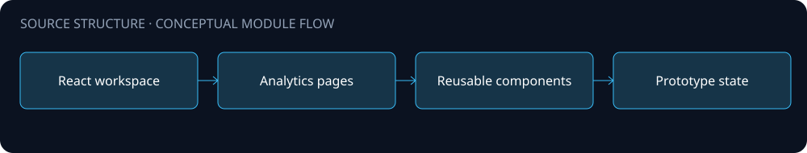
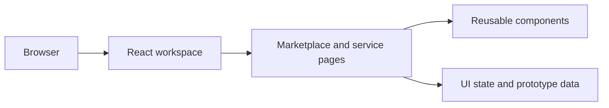

# Architecture

A React and TypeScript marketplace workspace prototype for AI-service discovery, creator tools, plan management and platform operations.

The diagram is a source-level orientation. Arrows describe intended module relationships; integration availability and end-to-end behavior were not validated for this public edition.

## Boundaries

- A browser prototype demonstrates consumer, creator and platform navigation.
- Components and pages make the interface structure reviewable.
- Prototype data and integration boundaries should be reviewed before connecting live services.

## Configuration and data

Configure your own environment and service endpoints. Never place API keys, production connection strings, customer records or uploaded documents in this repository. Public source omits operational assets and does not include a production deployment guarantee.
